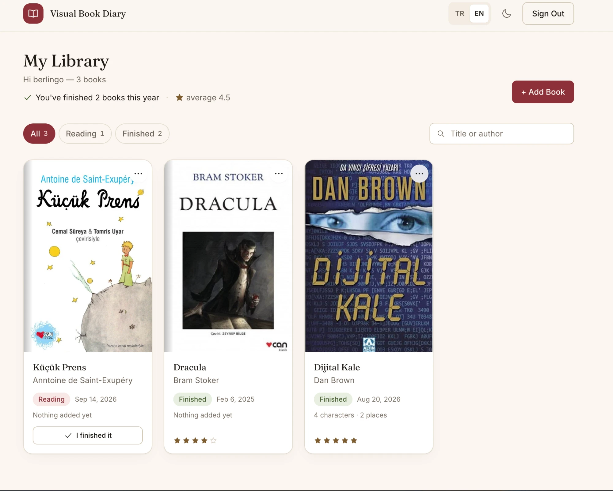
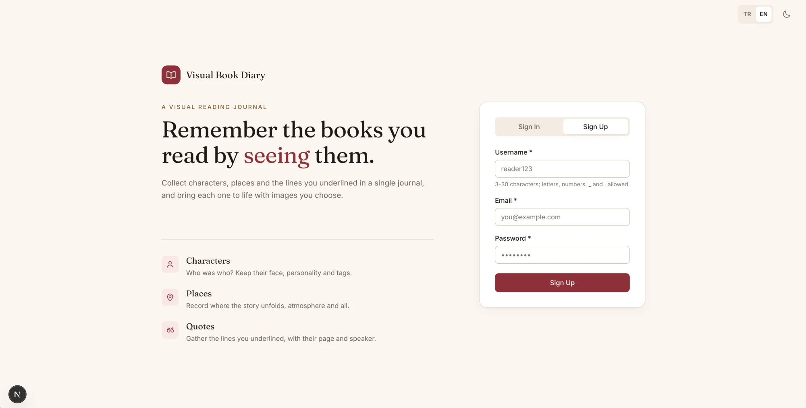
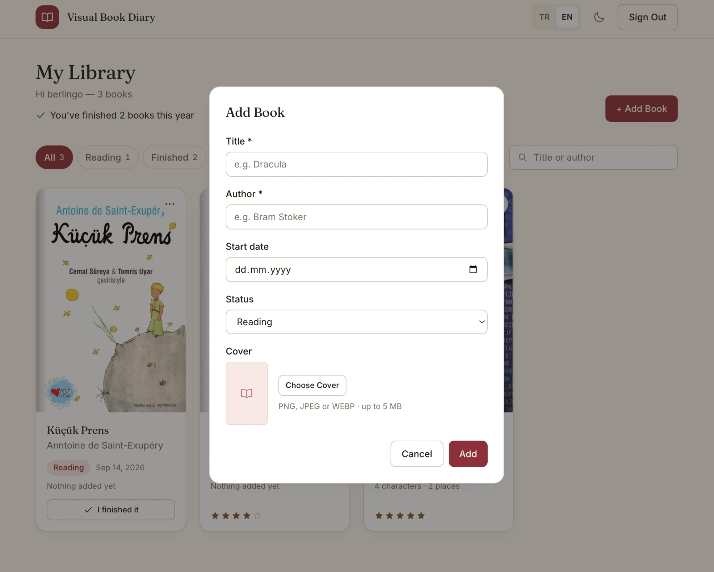
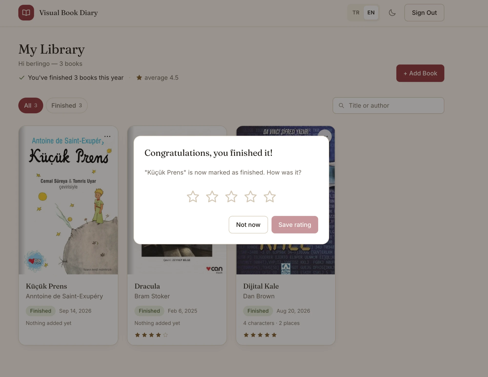

# Visual Book Diary

A personal reading journal for the things a book leaves behind — its **characters**, its **places**, and the **lines worth keeping**.

Most reading trackers stop at "finished / not finished". This one is about what you actually remember: a face you pictured, a city you walked through, a sentence you underlined. Books sit on a shelf with their covers; each one opens into its own visual directory.

**Türkçe:** [README.tr.md](README.tr.md)




---

## Features

**Library** — Books as cover cards (a typographic cover is generated when there is no image), filtered by status and searched with accent- and case-insensitive matching that handles Turkish characters. Filter state lives in the URL, so a filtered view is shareable and survives a refresh.

**Characters & locations** — Per book, a Pinterest-style masonry of cards with an image, a description, and multiple tags. The layout is pure CSS `columns` — no masonry library.

**Quotes** — Saved with page or chapter, optionally attached to a character. Deleting a character keeps its quotes; only the link is cleared.

**Finishing a book** — "I finished it" marks the book completed, records the local date, fires confetti, and offers a 5-star rating (skippable). The library header shows how many books you finished this year and their average rating.

**Bilingual UI** — Turkish and English, switchable from the header, stored in a cookie, guessed from `Accept-Language` on a first visit. Every user-facing string lives in a typed dictionary: a missing key is a compile error, not a blank label.

**Light & dark themes** — Chosen manually or inherited from the OS, applied in the first frame by a synchronous script so there is no flash of the wrong theme.

**Accounts** — Sign in with either an email address or a username.

---

## Screenshots

| | |
|---|---|
|  |  |
| Landing and sign-up | Adding a book, with cover upload |



Marking a book finished — confetti, and a rating you can skip.

---

## Tech stack

| Layer | Choice |
|---|---|
| Framework | Next.js 16 (App Router, Server Actions, Turbopack) · React 19 |
| Language | TypeScript (strict) |
| Styling | Tailwind CSS v4, theme tokens in `globals.css` |
| Database | Supabase Postgres with row-level security |
| Auth | Supabase Auth (email/username + password) |
| Files | Supabase Storage |
| Other | `canvas-confetti`, loaded dynamically and only on demand |

The only runtime dependency beyond the framework and Supabase is `canvas-confetti`. No UI kit, no state library, no masonry library, no date library.

---

## Getting started

**Requirements:** Node.js 20+ and a free [Supabase](https://supabase.com) project.

```bash
git clone <repository-url>
cd visual_book_diary
npm install
```

**1. Environment variables** — copy the template and fill it in from your Supabase project (Settings → API):

```bash
cp .env.example .env.local
```

| Variable | Where it runs |
|---|---|
| `NEXT_PUBLIC_SUPABASE_URL` | browser + server |
| `NEXT_PUBLIC_SUPABASE_ANON_KEY` | browser + server |
| `SUPABASE_SERVICE_ROLE_KEY` | **server only** — bypasses RLS, never expose it |

**2. Database** — open the Supabase SQL Editor, paste all of [`schema.sql`](schema.sql), and run it. It creates the tables, indexes, the new-user trigger, every RLS policy, the storage bucket with its policies, and the username lookup function.

**3. Run it:**

```bash
npm run dev
```

The app is at [http://localhost:3000](http://localhost:3000).

### Scripts

| Command | What it does |
|---|---|
| `npm run dev` | Development server |
| `npm run build` / `npm start` | Production build and server |
| `npm run lint` | ESLint |
| `npm run storage:orphans` | Report files left in Storage with no database record |
| `npm run storage:orphans -- --delete` | Delete those files (irreversible) |

Deploys to Vercel as-is: import the repository, add the three environment variables, done.

---

## Data model

```
profiles ──< books ──< characters ──< quotes
                   ├──< locations
                   └──< quotes
```

A book belongs to a user; characters, locations and quotes belong to a book. Deleting a book cascades to all of them. Deleting a character sets `quotes.character_id` to `NULL` so the quote survives.

Images are stored at `book-images/{userId}/{bookId}/{uuid}.{ext}` — a path that makes ownership checkable from the URL alone.

[`schema.sql`](schema.sql) sets up a fresh database in one run. [`migrations/`](migrations/) holds the incremental, idempotent changes applied to an existing one.

---

## Security

The app is small, but it is multi-tenant, so ownership is enforced in more than one place:

- **Row-level security on every table.** Ownership resolves through `books.user_id`; child tables check it with an `exists` subquery. Storage has its own policies — table RLS does not cover it — restricting writes to the user's own folder.
- **The service-role key never reaches the browser.** It lives in one `server-only` module and is used for exactly two things: resolving a username to an account at sign-in, and the orphan-cleanup script.
- **Username lookup is a `security definer` SQL function** with `search_path = ''`, and `EXECUTE` is granted to `service_role` alone. Sign-in failures return one generic message, so the form cannot be used to enumerate accounts.
- **Image URLs are validated, not trusted.** A URL is parsed and normalised before it is accepted into a record, and any path containing `%` is rejected — `../`, `%2e%2e` and `%2F` escapes would otherwise walk out of the user's folder. The same check gates deletion, so cleanup can only touch your own files.
- **Uploads are checked server-side** for session, book ownership, MIME type and size (5 MB). The client-side check exists only for early feedback.
- **Storage errors are logged, not returned.** Bucket paths and policy messages stay on the server.

**Known limitation:** the image bucket is public-read, so anyone holding an image URL can open it. The URLs contain a random UUID and are never listed publicly, but this is obscurity, not access control — private buckets with signed URLs would be the next step if the project ever went beyond personal use.

---

## Project structure

```
src/
├── app/                    routes (App Router)
│   ├── page.tsx            landing + sign in / sign up
│   ├── dashboard/          the library
│   ├── books/[id]/         book detail
│   ├── actions/            server actions (auth, books, entities, quotes, locale)
│   └── api/upload-image/   single upload endpoint
├── components/
│   ├── ui/                 primitives: button, modal, menu, star rating, …
│   ├── books/ entities/ quotes/
│   └── app-header, theme-toggle, locale-toggle, …
├── lib/
│   ├── supabase/           browser, server, admin clients
│   ├── storage/            upload, URL validation, cleanup, limits
│   ├── i18n/               dictionaries and locale resolution
│   └── books.ts, search.ts, format.ts, …
└── proxy.ts                session refresh + route protection
```

`proxy.ts` is Next 16's replacement for `middleware.ts`.

Design tokens live in `src/app/globals.css`; components use token utilities (`bg-paper`, `text-ink`, `border-line`, …) rather than raw colours, which is what keeps three theme states — light, OS dark, and explicitly chosen dark — consistent.

Accessibility was treated as part of the work, not a pass at the end: focus trapping and restoration in modals, `alertdialog` for destructive confirmations, roving tabindex on tabs and star ratings, a WAI-ARIA menu button, a visible focus ring everywhere, and confetti that respects `prefers-reduced-motion`.

---

## About

A personal project, built end to end — product requirements ([`docs/requirements.md`](docs/requirements.md), in Turkish), schema, design system and implementation.

Licensed under the [MIT License](LICENSE).
